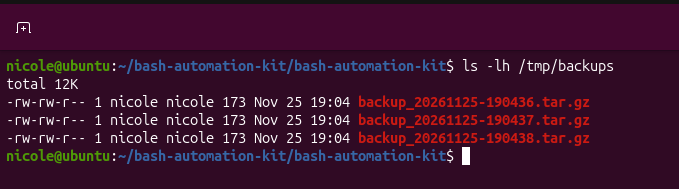
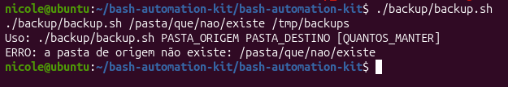
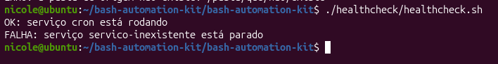

# 🛠️ bash-automation-kit


Kit de scripts Bash para automatizar tarefas do dia a dia de quem administra servidores Linux: **backup com rotação** e **health check de serviços**.

---

## 💡 Por que criei

Venho de mais de 2 anos em atendimento e suporte técnico e estou migrando para **DevOps e Cloud**. Este kit nasceu para praticar, na prática, o que eu aprendia nos laboratórios de Linux: transformar tarefas manuais e repetitivas em scripts seguros, que falham de forma clara e podem rodar sozinhos no cron.

---

## 📦 Estrutura

```
bash-automation-kit/
├── backup/
│   └── backup.sh          # backup com verificação de integridade e rotação
├── healthcheck/
│   └── healthcheck.sh     # verifica se serviços systemd estão ativos
├── docs/                  # prints de execução
├── LICENSE
└── README.md
```

## ✅ Requisitos

- Linux com Bash 4+
- `tar`, `gzip` e `coreutils` (já vêm na maioria das distribuições)
- `systemd` (somente para o `healthcheck.sh`)

## 🚀 Instalação

```bash
git clone https://github.com/nicolejsdev/bash-automation-kit.git
cd bash-automation-kit
chmod +x backup/backup.sh healthcheck/healthcheck.sh
```

---

## 💾 backup/backup.sh

Cria um backup compactado (`.tar.gz`) de uma pasta, confere se o arquivo gerado está íntegro e mantém apenas os backups mais recentes.

### Uso

```bash
./backup/backup.sh PASTA_ORIGEM PASTA_DESTINO [QUANTOS_MANTER]
```

| Argumento | Obrigatório | Descrição |
|---|---|---|
| `PASTA_ORIGEM` | Sim | Pasta que será copiada. Precisa existir. |
| `PASTA_DESTINO` | Sim | Onde os backups serão salvos. É criada se não existir. |
| `QUANTOS_MANTER` | Não | Quantidade de backups mantidos. Padrão: `7`. |

### Exemplo

```bash
./backup/backup.sh /var/www/meusite /backups 5
```

### 🔄 Rotação em ação

Rodei o script 4 vezes com `QUANTOS_MANTER=3`. Resultado: só os 3 backups mais recentes foram mantidos, e o mais antigo foi removido automaticamente.



### 🚫 Tratamento de erros

Sem argumentos, o script mostra como usar. Com uma pasta inexistente, ele para com uma mensagem clara e código de saída `1`.



### ⚙️ Como funciona

1. **Valida** os argumentos e verifica se a pasta de origem existe.
2. **Cria** o destino com `mkdir -p`.
3. **Gera** o arquivo `backup_AAAAMMDD-HHMMSS.tar.gz` com `tar -czf`.
4. **Verifica** a integridade com `tar -tzf`. Se estiver corrompido, o arquivo é removido e o script termina com erro.
5. **Rotaciona**: apaga os backups mais antigos, preservando só a quantidade definida.

### 🔢 Códigos de saída

| Código | Significado |
|---|---|
| `0` | Backup criado e verificado com sucesso |
| `1` | Argumentos ausentes, origem inexistente ou backup corrompido |

### ⏰ Agendando com cron

Backup diário às 02h, mantendo os 7 últimos:

```cron
0 2 * * * /caminho/para/bash-automation-kit/backup/backup.sh /var/www/meusite /backups 7 >> /var/log/backup.log 2>&1
```

---

## 🩺 healthcheck/healthcheck.sh

Verifica se serviços do `systemd` estão rodando e informa o resultado de cada um.

### Uso

```bash
./healthcheck/healthcheck.sh
```

A função `verificar_servico` recebe o nome de um serviço e usa `systemctl is-active` para checar o estado. Os serviços verificados ficam no final do script:

```bash
verificar_servico cron
verificar_servico servico-inexistente
```

Para monitorar outros serviços, basta adicionar linhas como `verificar_servico nginx` ou `verificar_servico docker`.

### Execução

O `cron` está ativo (`OK`) e o serviço inexistente é reportado como `FALHA`, exatamente o comportamento esperado.



---

## 🧠 Boas práticas aplicadas

- `set -euo pipefail`: o script para no primeiro erro, ao usar variável não definida ou ao falhar em qualquer parte de um pipe.
- Variáveis sempre entre aspas, para suportar caminhos com espaços.
- Mensagens de erro enviadas para `stderr` (`>&2`).
- Verificação de integridade antes de considerar o backup válido.
- Valores padrão com `${VAR:-padrão}`.

## 🗺️ Roadmap

- [ ] Alertas do health check via webhook (Telegram/Discord)
- [ ] Script de hardening para servidor novo (SSH, firewall, fail2ban, usuários)
- [ ] Validação automática com ShellCheck via GitHub Actions

## 📄 Licença

Distribuído sob a licença MIT. Veja o arquivo [LICENSE](LICENSE) para mais detalhes.

## 👩‍💻 Autora

**Nicole Chagas** · [@nicolejsdev](https://github.com/nicolejsdev) · [LinkedIn](https://www.linkedin.com/in/nicole-chagas-a30a08259/)
